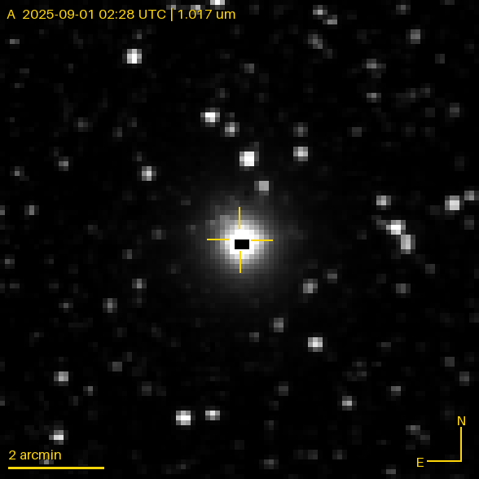
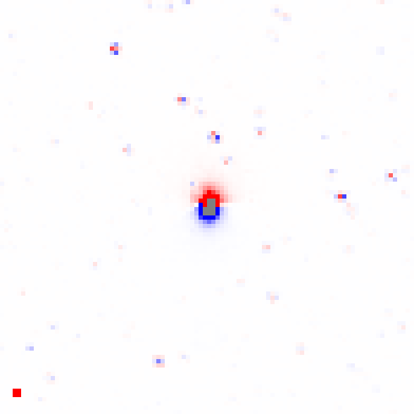

# ALKA Chronos: SPHEREx Sky Blink Explorer

NASA Space Apps Challenge 2026 solo project.

ALKA Chronos lets anyone pick a position on the sky, find two SPHEREx observations of it taken at
different times, and blink between them to spot anything that moved or changed brightness. It uses real
SPHEREx spectral images from the NASA/IPAC Infrared Science Archive (IRSA).



*Barnard's Star, the fastest-moving star in the sky, seen by SPHEREx on 2025-09-01 and 2026-08-25.
The background stars stay put; Barnard's Star steps north.*

## What it does

1. **Search.** For a right ascension and declination, it lists every SPHEREx exposure in a chosen band
   that covers the position (IRSA Simple Image Access service).
2. **Match.** It offers pairs of exposures that are comparable: same detector, nearly the same wavelength
   at the target, and separated by the time gap you choose.
3. **Download.** It fetches a small cutout of each exposure from IRSA's cutout service instead of the
   full 66 MB file.
4. **Align.** Both cutouts are resampled onto one north-up sky grid, and the zodiacal light and remaining
   background are removed.
5. **Blink.** Both images are shown with one shared brightness scale: automatic blink, manual flip,
   side by side, a difference image, and the observation details.

## Run it

```bash
git clone https://github.com/Alka-7/ALKA-Chronos.git
cd ALKA-Chronos
python3 -m venv .venv && source .venv/bin/activate
pip install -r requirements.txt
streamlit run app.py
```

Then open `http://localhost:8501`. The **Bundled example** data source works without any network
access; the **Live NASA/IPAC archive** source needs to reach `irsa.ipac.caltech.edu`.


### Command line

```bash
python scripts/blink.py --ra 270 --dec 66.56 --band 1 --size 15 --name my_target
python scripts/blink.py --ra 270 --dec 66.56 --band 4 --list     # only list observations and pairs
```

This writes a blink GIF, a side-by-side picture and a difference picture to `figures/`, a small aligned
pair to `examples/` (loadable by the app), and the full observation inventory to `data/inventory/`.

### Tests

```bash
pip install pytest
python -m pytest -q
```

The tests run offline on synthetic star fields and the bundled examples.

## Results and validation

| Target | Epochs | What the blink shows |
|---|---|---|
| Barnard's Star (RA 269.447°, Dec +4.768°), band 1 | 2025-09-01 and 2026-08-25 (359 days) | The star shifts by 11.1″ north and 1.8″ west, measured by fitting its profile in both epochs. Its catalogued proper motion predicts 10.2″ north and 0.8″ west over the same interval. Background stars do not move. |
| North ecliptic pole deep field (RA 270.0°, Dec +66.56°), band 1 | 2025-04-25 and 2026-10-04 (527 days) | A static field: stars and the galaxy NGC 6552 coincide in both epochs, with no moving object. 5,208 band-1 exposures cover this position. |

Each pair also passes an automatic alignment check (the star fields match best at zero shift).
The Barnard's Star difference image shows the expected signature of motion, a fainter patch where the
star was next to a brighter patch where it arrived:



No new moving object is claimed. The tool is a comparator, not a detection pipeline.

## Limitations

- **Wavelength varies across each image.** Every SPHEREx detector sits behind a linear variable filter,
  so an object's wavelength depends on where it lands on the detector. Pairs are matched at the target
  position only; away from the centre the two images are at slightly different wavelengths, so small
  brightness differences there are not evidence of variability.
- **Large pixels.** SPHEREx pixels are 6.15″ and stars are barely resolved, so stars flicker a little
  between frames and leave small red/blue specks in the difference image.
- **Saturation and artifacts.** Very bright stars have masked cores (shown black). Single bright pixels
  in one frame are usually cosmic rays or detector artifacts.
- **Airglow.** Helium in Earth's upper atmosphere glows at 1.083 µm and appears in band 1 as a stripe
  that changes between exposures. Pairs near that wavelength are not offered.
- **Coverage.** Away from the ecliptic poles a position is seen at a given wavelength only a few times a
  year, so some targets have few or no comparable pairs.
- **Archive load.** IRSA's cutout service sometimes answers "server busy"; the tool retries
  automatically, which can take up to a minute.
- **Slow movers.** A body 500 au away shifts by roughly a quarter of a degree over six months, mostly
  from Earth's own motion. Finding one needs wide fields, many epochs and confirmation, which this
  prototype does not automate.

## Repository layout

```
app.py                      Streamlit interface
src/chronos/archive.py      IRSA search, pair matching, cutout download
src/chronos/imaging.py      FITS reading, alignment, scaling, rendering
src/chronos/pipeline.py     download-align-render steps shared by the app and the script
src/chronos/data/           wavelength lookup grids read from the SPHEREx files
scripts/blink.py            command-line version
scripts/build_wave_grids.py rebuilds the wavelength lookup from the archive
examples/                   small aligned pairs and a sample observation inventory
figures/                    result pictures
tests/                      offline tests
DEVLOG.md                   development log
```

Raw downloads go to `data/`, which is not committed.

## Data, tools and credits

- **Data:** SPHEREx spectral images (Data Release 1 and Quick Release 3 collections) from the
  NASA/IPAC Infrared Science Archive, <https://irsa.ipac.caltech.edu/Missions/spherex.html>, accessed
  through IRSA's Simple Image Access and cutout services. SPHEREx is a NASA mission managed by JPL;
  IRSA is operated by Caltech/IPAC.
- **Libraries:** Astropy, Astroquery, Reproject, NumPy, pandas, Pillow, Requests, Streamlit.
- ### AI Tools Disclosure

ALKA Chronos was developed with assistance from Claude Code (Anthropic) and ChatGPT (OpenAI).

**Claude Code** assisted with Python implementation, the SPHEREx image-processing workflow, debugging, and technical documentation.

**ChatGPT** assisted with project planning, technical explanations, Streamlit prototype development, debugging, and Git/GitHub troubleshooting.

The author is responsible for the project's scientific interpretation, verification of results, and final submission.

The repository includes both a SPHEREx image-comparison workflow and a separate demonstration using simulated FITS observations. Simulated data are identified as such and must not be represented as real SPHEREx observations.

Any AI-generated visual assets included in the final submission will be identified and labeled in accordance with the competition requirements.-
 **Barnard's Star proper motion** used for the validation: −0.80″/yr in right ascension and
  +10.36″/yr in declination (Gaia DR3 values, rounded).

All work in this repository was created during the NASA Space Apps Challenge 2026 (November 14-15).
